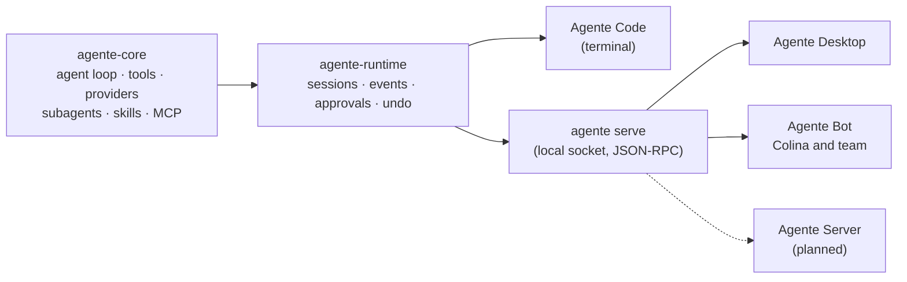

<p align="center">
  
</p>

<h1 align="center">Agente</h1>

<p align="center">
  <strong>One agent core in Rust, four ways to use it.</strong><br />
  In your terminal, on your desktop, as a team of bots, and (soon) on a server. Any model, any provider, your keys.
</p>

---

## The family

| | What it is | Status |
|---|---|---|
| **Agente Code** | A keyboard-first coding agent for the terminal (`agente`) | Available: Linux, Windows |
| **Agente Desktop** | The desktop app: chat, local models, voice, artifacts, and a Code section on the same core | Available: Linux, Windows |
| **Agente Bot** | Named bots with their own persona, memory, model and routines, handing work to each other. **Colina** is the first | Core done; the Desktop Bots screen is next |
| **Agente Server** | The same runtime headless, in Docker, for your bots and your team | Planned |

They are not four agents. There is one: the Rust core in `crates/agente-core`, run by one runtime. The terminal uses it directly; Desktop and the bots talk to it through `agente serve`, a local background service. A fix or a new tool lands everywhere at once.



## Install

**Linux** (x86_64 and arm64): Agente Code into `~/.local/bin`.

```bash
curl -fsSL https://raw.githubusercontent.com/fabricio3g/AgenteCode/main/install.sh | sh
```

Add `--desktop` for Agente Desktop too (an AppImage with an app menu entry), or `--desktop-only`:

```bash
curl -fsSL https://raw.githubusercontent.com/fabricio3g/AgenteCode/main/install.sh | sh -s -- --desktop
```

**Windows** (x64, PowerShell): Agente Code into `%LOCALAPPDATA%\Agente\bin`, added to your PATH.

```powershell
irm https://raw.githubusercontent.com/fabricio3g/AgenteCode/main/install.ps1 | iex
```

With Agente Desktop too (runs its installer):

```powershell
& ([scriptblock]::Create((irm https://raw.githubusercontent.com/fabricio3g/AgenteCode/main/install.ps1))) -Desktop
```

Both scripts check every download against the release's `SHA256SUMS`, and take `--version vX.Y.Z` / `-Version vX.Y.Z`. Every file is also on the [Releases](https://github.com/fabricio3g/AgenteCode/releases) page.

**From source** (Rust 1.88+):

```bash
git clone https://github.com/fabricio3g/AgenteCode
cd AgenteCode
cargo build --release          # target/release/agente
```

---

## Agente Code

A calm, fast terminal UI over the full agent: plan, build or auto mode, parallel tools, background subagents in their own git worktrees, skills, MCP servers, and honest cost numbers.

```bash
agente                                   # the TUI in the current folder
agente -p ~/src/my-app                   # … in another project
agente "refactor the auth module"        # start with a prompt
agente --no-tui "fix the failing test"   # headless, auto-approving tools
agente --resume                          # reopen a saved session
```

1. Connect a provider with `/provider`. Keys are stored in `~/.agente/auth.json`, never in config files.
2. Pick a model with `/model`, and a reasoning effort with `Ctrl+T` when the model has one.
3. Type what you want: `@` mentions files, `/` runs commands, `Ctrl+P` opens everything else.

| | |
|---|---|
| **Providers** | 45+ built in (OpenRouter, OpenCode Go, DeepSeek, Z.AI/GLM, MiniMax, Kimi, Qwen, OpenAI, Groq, Mistral, xAI, Ollama, LM Studio, …) plus any OpenAI-, Anthropic- or Gemini-compatible endpoint. |
| **Modes** | `plan` (read-only, ends with a plan you accept or revise), `build`, and `auto` (build without asking, except for destructive commands). `Shift+Tab` cycles. |
| **Subagents** | `explore`, `plan`, `general-purpose` and your own from `.agente/agents/*.md`; up to 8 at once, each with a live card and its own cost. |
| **Skills** | [Agent Skills](https://agentskills.io/specification) from `.agente/skills`, `.agents/skills` or `.claude/skills`, picked by the agent or run with `/skill-name`. |
| **MCP** | stdio and Streamable HTTP servers from `agente.json` or the project's `.mcp.json` (approved first). Read-only tools run unasked. |
| **Background processes** | Dev servers and watchers keep running after a tool call; list, read and stop them. |
| **Media** | Paste or drop images, audio, video and PDFs, sent natively to models that accept them. |
| **Sessions** | Every session is saved. Revert to any message (undoing the file edits since) or fork from it. |
| **Safety** | Approval cards with real diffs, per-tool permissions, undo/redo of edits, secrets redacted from logs. |
| **Embedding** | `--acp-stdio` speaks the Agent Client Protocol for editors; `--no-tui` runs headless in CI. |

The status row under the composer reads `mode │ $spend · cache% │ context`. `~$0.04` is an estimate from catalog prices, `$0.04+` means some calls had no known price, and `free` means the provider charged nothing.

<details>
<summary>Keyboard</summary>

| Key | Action |
|---|---|
| `Enter` | Send · while working: queue · again on an empty composer: send the queue now |
| `Shift+Tab` | Cycle plan → build → auto |
| `Esc` `Esc` | Interrupt the running turn |
| `Ctrl+P` | Command palette |
| `Ctrl+T` | Reasoning effort |
| `Ctrl+V` | Paste text, or attach a screenshot |
| `Ctrl+X` | Subagents |
| `Ctrl+S` / `Ctrl+N` | Session picker / new session |
| `F2`, `Ctrl+PgUp` / `Ctrl+PgDn` | New tab, switch tabs |
| `Ctrl+O` | Edit the prompt in your `$EDITOR` |
| `Ctrl+B` | This session's file changes |
| `?` / `F1` | All shortcuts |

Commands worth knowing: `/settings`, `/skills`, `/mcp`, `/compact`, `/undo`, `/redo`, `/init` (writes an `AGENTS.md` for your project), `/doctor`.

</details>

<details>
<summary>Configuration, skills and MCP</summary>

Settings merge from `~/.agente/config.json` and the project's `agente.json` (the project wins); most are also in `/settings`. See [`agente.json.example`](agente.json.example) for every field.

A skill is a folder with a `SKILL.md`:

```markdown
---
name: release-notes
description: Draft release notes from merged PRs. Use when the user asks for a changelog.
---
1. Run `scripts/collect.sh <tag>` to list the merged PRs.
2. …
```

MCP servers:

```json
{
  "mcp": {
    "docs":   { "command": ["npx", "-y", "@acme/docs-mcp"] },
    "sentry": { "type": "http", "url": "https://mcp.sentry.dev/mcp",
                "headers": { "Authorization": "Bearer $SENTRY_TOKEN" } }
  }
}
```

</details>

---

## Agente Desktop

The desktop app for people who'd rather not live in a terminal, and for everything that isn't code.

- **Chat** with any provider, or with **local models** that run on your machine. llama.cpp ships inside the app in every build its project publishes for your OS: CPU, Vulkan (any GPU), CUDA 12 (NVIDIA), ROCm (AMD) and SYCL (Intel). The app picks CUDA on NVIDIA and Vulkan elsewhere.
- **Voice**: speech-to-text with the bundled whisper.cpp, and text-to-speech.
- **Artifacts**: documents, slides and pages the assistant makes, viewed and kept beside the chat.
- **Code**: the same agent as Agente Code with Desktop's UI: transcript, approvals with diffs, changes, processes and a built-in browser the agent can drive. It runs on the Rust core through `agente serve` (Linux today; Windows is being finished).

Built with Electron, Svelte and TypeScript in [`apps/desktop`](apps/desktop) ([its README](apps/desktop/README.md)).

```bash
cd apps/desktop
npm install
npm run dev
```

---

## Agente Bot

A roster of named bots, each with its own persona, memory, model and schedule, that hand work to one another. **Colina**, your everyday assistant, is there from the start and can't be deleted; add others (a researcher, a reviewer, a writer) as you need them.

Each bot is a folder you can read and edit:

```text
~/.agente/bots/colina/
  bot.toml        title, role, avatar, model, tools, daily budget
  SOUL.md         who the bot is and how it works
  USER.md         what it knows about you
  MEMORY.md       notes it keeps for itself, one per line
  routines.toml   what it does on a schedule
  workspace/      where its tools work
```

- **Persona and memory.** Every turn starts from the bot's files, so what it remembered yesterday is in today's conversation. It edits its own memory with `memory_update`, a note at a time, within a 4,000-character cap.
- **Handoffs.** `message_bot` hands a task to a teammate and brings back the answer. The teammate works in its own chat, on its own model, never with more trust than the bot that asked, and can't pass the task on again (no loops).
- **Routines.** Prompts a bot runs on a schedule (hourly, daily, weekdays, weekly or cron), each answer landing in its chat. A run missed while your computer slept happens once when it wakes.
- **One conversation per bot.** A bot keeps a single chat, so it builds up context instead of starting over.

Bots run inside `agente serve`. The Bots screen in Desktop is being built; until then they're reachable over its socket (`bots.*` and `routines.*`, below).

---

## Agente Server

`agente serve` is the runtime as a long-lived service: one process that Desktop, a second terminal and the bots share, so a session started in one place can be watched or continued in another.

```bash
agente serve             # listen on $XDG_RUNTIME_DIR/agente/agente.sock (this user only)
agente serve --status    # is one running?
```

It speaks JSON-RPC 2.0, one message per line: `session.*`, `turn.start|cancel|steer`, `approval.respond`, `edits.undo|redo|rewind`, `events.subscribe`, `processes.*`, `bots.*`, `routines.*`. The Docker image (**Agente Server**) with remote access and messaging channels for the bots is planned next.

---

## Repository

| Path | What it holds |
|---|---|
| `crates/agente-core` | The agent: loop, tools, providers, permissions, subagents, skills, MCP, compaction |
| `crates/agente-runtime` | Sessions, events, approvals, undo/redo, per-session projects and modes |
| `crates/agente-daemon` | `agente serve`: the socket, bots and routines |
| `crates/agente-bot` | Bot folders, personas, memory and routine schedules |
| `crates/agente-tui` | The terminal UI |
| `crates/agente-cli` | The `agente` binary: TUI, headless, ACP, `serve` |
| `crates/agente-{protocol,session,acp,node}` | Shared types, persistence, editor embedding, Node bindings |
| `apps/desktop` | Agente Desktop |

## Development

```bash
cargo check                     # zero warnings, enforced
cargo test --workspace
cargo clippy --workspace --all-targets -- -D warnings
```

Desktop has its own toolchain inside `apps/desktop` (`npm install`, `npm run dev`, `npm test`, `npm run check`, `npm run fallow:audit`). CI runs the Rust and Desktop jobs when their folders change.

- [AGENTS.md](AGENTS.md): architecture and the design decisions behind the UI; read it before a larger change.
- [docs/RELEASING.md](docs/RELEASING.md): a version tag builds and publishes Agente Code and Agente Desktop for Linux and Windows.

Brand assets live in `assets/brand/`. The wordmark is outlined from [Space Grotesk](https://github.com/floriankarsten/space-grotesk) Medium (SIL Open Font License 1.1).

## License

[MIT](LICENSE)
