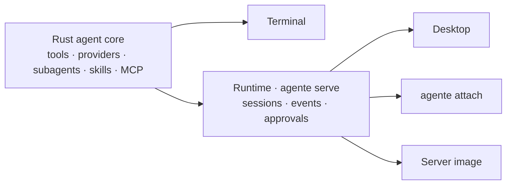

<p align="center">
  <picture>
    <source media="(prefers-color-scheme: dark)" srcset="assets/brand/agente-code-lockup-on-dark.svg" />
    
  </picture>
</p>

<p align="center">
  <strong>One agent for your desktop, your terminal and your server.</strong><br />
  Agente Code plans, edits and builds with you. Bring any model, read every step<br />
  as it happens, and approve every change before it lands.
</p>

<p align="center">
  <a href="https://github.com/fabricio3g/AgenteCode/releases/latest"></a>
  <a href="https://github.com/fabricio3g/AgenteCode/actions/workflows/rust.yml"></a>
  <a href="https://github.com/fabricio3g/AgenteCode/actions/workflows/desktop.yml"></a>
  <a href="LICENSE"></a>
</p>

<p align="center">
  <a href="#install">Install</a> ·
  <a href="#desktop">Desktop</a> ·
  <a href="#terminal">Terminal</a> ·
  <a href="#server">Server</a> ·
  <a href="#models">Models</a> ·
  <a href="#development">Development</a>
</p>

<p align="center">
  
</p>

## Three surfaces, one core

The same Rust agent runs all three, so a session, a model or a tool behaves the same wherever you use it.

| | For | Get it |
|---|---|---|
| **[Desktop](#desktop)** | The whole task: chat and research, files you can download, a project workspace, design, local models, voice | Installer for Windows and Linux |
| **[Terminal](#terminal)** | Working in a repository without leaving your shell | One binary for Windows and Linux |
| **[Server](#server)** <sup>preview</sup> | Sessions that keep running on a machine you control | `agente serve` or the Docker image |

**You keep the last word.** Edits and commands wait for a yes: Enter allows, Esc denies, and destructive calls are marked in red. Start read-only with a plan, revert or fork from any message, and see what each call costs.

## Install

> [!NOTE]
> The repository is private. Open release links while signed in with an account that has access, or use the [GitHub CLI](https://cli.github.com) after `gh auth login`. Anonymous downloads return 404.

### Desktop

| Platform | Download |
|---|---|
| Windows x64 | [AgenteDesktop-windows-x64.exe](https://github.com/fabricio3g/AgenteCode/releases/latest/download/AgenteDesktop-windows-x64.exe) |
| Linux x64 | [AgenteDesktop-linux-x64.AppImage](https://github.com/fabricio3g/AgenteCode/releases/latest/download/AgenteDesktop-linux-x64.AppImage) |
| Debian / Ubuntu amd64 | [AgenteDesktop-linux-amd64.deb](https://github.com/fabricio3g/AgenteCode/releases/latest/download/AgenteDesktop-linux-amd64.deb) |

- **Windows:** run the installer. It is not code-signed yet, so SmartScreen may ask you to confirm.
- **Linux:** `chmod +x` the AppImage and run it (needs FUSE 2: `libfuse2t64` on recent Ubuntu), or `sudo apt install ./AgenteDesktop-linux-amd64.deb`.
- **macOS:** build from source with the [Desktop guide](apps/desktop/README.md).

Desktop bundles its own `agente` runtime and CPU, Vulkan, CUDA and SYCL inference runtimes; ROCm is a download from inside the app. Each release includes a size report for the installers.

### Terminal

```bash
mkdir -p ~/.local/bin
gh release download --repo fabricio3g/AgenteCode --pattern AgenteCode-linux-x64 \
  --output ~/.local/bin/agente --clobber
chmod +x ~/.local/bin/agente
agente --version
```

| Platform | Download |
|---|---|
| Linux x64 | [AgenteCode-linux-x64](https://github.com/fabricio3g/AgenteCode/releases/latest/download/AgenteCode-linux-x64) |
| Linux arm64 | [AgenteCode-linux-arm64](https://github.com/fabricio3g/AgenteCode/releases/latest/download/AgenteCode-linux-arm64) |
| Debian / Ubuntu | [amd64 .deb](https://github.com/fabricio3g/AgenteCode/releases/latest/download/AgenteCode-linux-amd64.deb) · [arm64 .deb](https://github.com/fabricio3g/AgenteCode/releases/latest/download/AgenteCode-linux-arm64.deb) |
| Windows x64 | [AgenteCode-windows-x64.exe](https://github.com/fabricio3g/AgenteCode/releases/latest/download/AgenteCode-windows-x64.exe) |

Make sure `~/.local/bin` is on your `PATH`. The `.deb` packages install `agente` with a terminal launcher and icons. On Windows, rename the download to `agente.exe` and put it in a folder on your `PATH`.

Verify downloads with [AgenteCode-SHA256SUMS](https://github.com/fabricio3g/AgenteCode/releases/latest/download/AgenteCode-SHA256SUMS) and [AgenteDesktop-SHA256SUMS](https://github.com/fabricio3g/AgenteCode/releases/latest/download/AgenteDesktop-SHA256SUMS).

<details>
<summary><strong>Run Desktop from source</strong></summary>

With stable Rust, Node.js 22.12+ and your platform's native build tools:

```bash
git clone https://github.com/fabricio3g/AgenteCode.git
cd AgenteCode/apps/desktop
npm install
npm --prefix renderer install
CARGO_BUILD_JOBS=2 npm run dev
```

`npm run dev` builds `agente`, then starts Electron and the renderer. The [Desktop guide](apps/desktop/README.md) covers native modules and local-model setup.

</details>

## Desktop

**A calm workspace for the whole task.** Ask in Home and get documents, decks and spreadsheets back as files. Switch to Code for a project, or Design for pages you can point at.

<p align="center">
  
</p>

- **Home** — chat and research with cloud or local models, web search, and artifacts (pages, documents, slides, spreadsheets) you preview, edit and download.
- **Code** — the Rust coding agent on a project, with approvals in the composer, diffs in the transcript, and docked changes, terminals, processes and a browser. Each conversation keeps its own layout.
- **Design** — plain HTML pages on a board you pan and zoom. Select or comment on elements, draw on the canvas, compare variants, and hand the result to Code.
- **Local models** — manage GGUF models and llama.cpp runtimes, with CPU and GPU backends picked for your machine.
- **Voice** — dictate with whisper.cpp and listen to replies.
- **Yours to tune** — dark and light themes, text size and accessibility settings, and seven languages: English, Spanish, Brazilian Portuguese, Chinese, French, German and Japanese. Roleplay is an optional space you can turn on in Settings.

## Terminal

**Stay in your repository. Keep control of the work.** A keyboard-first agent with a quiet transcript, session tabs, live tool output and an approval card docked above the prompt.

<p align="center">
  
</p>

```bash
agente                                   # open in this folder
agente -p ~/src/my-app                   # work in another project
agente "refactor the auth module"        # start with a prompt
agente --resume                          # pick a saved session to reopen
agente --no-tui "fix the failing test"   # headless; add --no-auto-approve to keep prompts
```

First run: connect a provider with `/provider`, pick a model with `/model` (`Ctrl+T` sets the reasoning level), then describe the task. Mention files with `@`, run commands with `/`, open everything else with `Ctrl+P`.

| | |
|---|---|
| **Plan → build → auto** | Start read-only with a plan, approve tools as you build, or approve a whole turn. `Shift+Tab` cycles. |
| **Subagents** | Explore, plan and general-purpose children run in parallel; writing children get their own git worktree. |
| **Sessions and tabs** | Several sessions at once, queue or steer a running turn, revert or fork from any message, resume after quitting. |
| **Skills and MCP** | [Agent Skills](https://agentskills.io/specification), custom agents, and MCP servers over stdio or Streamable HTTP. |
| **Changes and processes** | Diffs, undo/redo, and live output from dev servers and watchers you can stop. |
| **Media** | Images, audio, video and PDFs for models that accept them. |
| **Context and spend** | Automatic compaction, prompt caching, a context meter, and cost per call and per subagent. Estimates are labelled. |
| **Editors and scripts** | `--acp-stdio` for the Agent Client Protocol; `--no-tui` for CI. |

<details>
<summary><strong>Keyboard shortcuts</strong></summary>

| Key | Action |
|---|---|
| `Enter` | Send; while a turn runs, queue; on an empty prompt, send the queue now |
| `Shift+Tab` | Cycle plan → build → auto |
| `Esc` `Esc` | Interrupt the turn |
| `Ctrl+P` | Command palette |
| `Ctrl+T` | Reasoning level |
| `Ctrl+V` | Paste text or attach a clipboard image |
| `Ctrl+X` | Subagents |
| `Ctrl+S` / `Ctrl+N` | Session picker / new session |
| `F2` | New tab |
| `Ctrl+PgUp` / `Ctrl+PgDn` | Switch tabs |
| `PageUp` / `PageDown` | Scroll the transcript |
| `Ctrl+O` | Edit the prompt in `$EDITOR` |
| `Ctrl+B` | Show session changes |
| `?` / `F1` | All shortcuts |

Useful commands: `/settings`, `/skills`, `/mcp`, `/compact`, `/undo`, `/redo`, `/init`, `/doctor`.

</details>

<details>
<summary><strong>Configuration</strong></summary>

Settings merge from `~/.agente/config.json` and the project's `agente.json` (the project wins); provider keys live in `~/.agente/auth.json`. [`agente.json.example`](agente.json.example) lists the fields, and [Provider routing and caching](docs/PROVIDERS.md) explains how routes and cache rules are chosen.

- **Skills:** folders with a `SKILL.md` in `.agente/skills`, `.agents/skills` or `.claude/skills`, in the project or your home folder. The agent picks one when it fits, or you call `/skill-name`.
- **Custom agents:** Markdown definitions in `.agente/agents/*.md`.
- **MCP:** servers in `agente.json` or the project's `.mcp.json`. Project servers wait for your approval; read-only tools also work in Plan mode.
- **Browser and Google Workspace:** `agente bridge install` adds your real browser and Google Docs, Sheets and Drive as tools ([guide](docs/GOOGLE_WORKSPACE.md)).

The status row reads `mode │ $spend · cache% │ context`: `~` marks a catalog estimate, `+` means some calls were unpriced, and `free` means the provider charged nothing.

</details>

## Server

**Start a task, close the laptop, attach later.** The runtime behind Desktop also runs headless.

```bash
agente serve                 # start the local service
agente serve --status        # is it running?
agente attach                # join the latest session from any terminal
```

To host it yourself, run the preview image `ghcr.io/fabricio3g/agente-server` with a token:

```bash
export AGENTE_TOKEN=$(openssl rand -hex 32)
docker run -d --name agente \
  -p 127.0.0.1:7420:7420 \
  -e AGENTE_TOKEN -e OPENROUTER_API_KEY \
  -v agente-data:/home/agente/.agente \
  -v "$PWD/workspace:/workspace" \
  ghcr.io/fabricio3g/agente-server:latest
```

Remote connections are not encrypted: put a tunnel or TLS proxy in front. The [Server guide](docs/SERVER.md) covers storage, providers and remote attach.

## Models

Bring your own key, or nothing at all.

- **Cloud:** OpenRouter, OpenCode Go, DeepSeek, Z.AI (GLM) and MiniMax.
- **Local:** llama.cpp, Ollama and LM Studio.
- **Anything else** that speaks the OpenAI API, as a custom provider.

Services whose terms forbid using your key from a third-party app (OpenAI, Anthropic and Gemini directly) are left out; their models are still available through OpenRouter. Tools, reasoning levels and media follow what each model supports.

## How it fits together



The terminal uses the core directly; Desktop's Code space and the server go through the runtime. Home and Design add Desktop's own inference and artifact tools.

<details>
<summary><strong>Repository map</strong></summary>

| Path | Purpose |
|---|---|
| `crates/agente-core` | Agent loop, tools, providers, permissions, subagents, skills, MCP, compaction |
| `crates/agente-runtime` | Sessions, events, approvals, undo/redo |
| `crates/agente-daemon` | `agente serve` and its transports |
| `crates/agente-tui` | Terminal UI |
| `crates/agente-cli` | The `agente` binary: TUI, headless, ACP, serve, attach, bridge |
| `crates/agente-bridge` | Browser-extension hub and Google Workspace tools |
| `crates/agente-{protocol,session,acp,node,audio,computer}` | Shared types, persistence, editor protocol, Node bindings, audio, computer use |
| `apps/desktop` | Electron + Svelte desktop app and the browser extension |
| `site/` | The landing page |
| `assets/brand/` | Icon, lockups and favicon, generated by `crates/agente-tui/examples/gen_brand.rs` |

</details>

## Development

Build the terminal binary from the repository root:

```bash
CARGO_BUILD_JOBS=2 cargo build --release --bin agente -j 2
./target/release/agente --version        # Windows: target\release\agente.exe
```

Check one crate at a time (substitute the one you changed):

```bash
cargo fmt --all -- --check
CARGO_BUILD_JOBS=2 cargo check -p agente-core -j 2
CARGO_BUILD_JOBS=2 cargo test -p agente-core -j 2
CARGO_BUILD_JOBS=2 cargo clippy -p agente-core --all-targets -j 2 -- -D warnings
```

Desktop, from `apps/desktop`:

```bash
npm run check
npm --prefix renderer test
npm test
npm run fallow:audit
node scripts/gen-protocol-types.mjs --check
```

| Guide | What's inside |
|---|---|
| [Project context](AGENTS.md) | Architecture, design decisions and contributor rules |
| [Desktop development](apps/desktop/docs/DEVELOPMENT.md) | Toolchain and native-module troubleshooting |
| [Providers](docs/PROVIDERS.md) | Routing, caching and adding a provider |
| [Server](docs/SERVER.md) | Self-hosting and remote sessions |
| [Releasing](docs/RELEASING.md) | Building and publishing the CLI and Desktop |

## License

[MIT](LICENSE). Brand assets are in [`assets/brand`](assets/brand); the wordmark is set in [Space Grotesk](https://github.com/floriankarsten/space-grotesk) (SIL Open Font License 1.1).
