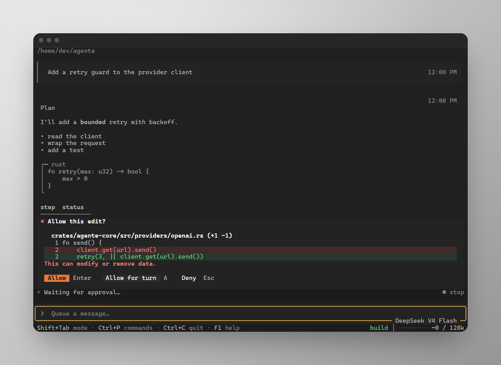
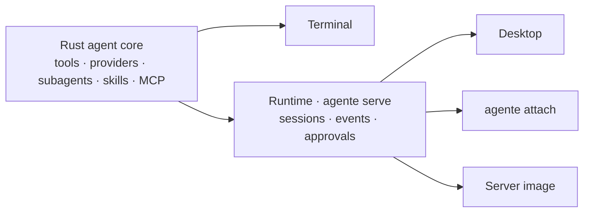

<p align="center">
  <picture>
    <source media="(prefers-color-scheme: dark)" srcset="assets/brand/agente-code-lockup-on-dark.svg" />
    
  </picture>
</p>

<p align="center">
  <strong>A Rust coding agent and local AI workspace for desktop, terminal, and server.</strong><br />
  Connect cloud or local models, inspect tool calls and diffs in real time,<br />
  and approve file edits and shell commands before they run.
</p>

<p align="center">
  <a href="https://github.com/fabricio3g/AgenteCode/releases/latest"></a>
  <a href="https://github.com/fabricio3g/AgenteCode/actions/workflows/rust.yml"></a>
  <a href="https://github.com/fabricio3g/AgenteCode/actions/workflows/desktop.yml"></a>
  <a href="LICENSE"></a>
</p>

<p align="center">
  <a href="#install">Install</a> ·
  <a href="#desktop">Desktop</a> ·
  <a href="#terminal">Terminal</a> ·
  <a href="#server">Server</a> ·
  <a href="#models">Models</a> ·
  <a href="#development">Development</a>
</p>

<p align="center">
  
</p>

## Overview

The desktop app, terminal UI, and headless server share the same Rust agent core, session format, model configuration, and tool permissions.

| Surface | Use case | Distribution |
|---|---|---|
| **[Desktop](#desktop)** | Chat, web research, downloadable file artifacts, project coding workspace, HTML design canvas, local GGUF models, and voice | Installer for Windows and Linux |
| **[Terminal](#terminal)** | Interactive coding agent in a local repository | Single binary for Windows and Linux |
| **[Server](#server)** <sup>preview</sup> | Headless daemon for persistent and remote sessions | `agente serve` or Docker image |

By default, file edits and shell commands require confirmation (`Enter` to allow, `Esc` to deny; destructive commands are highlighted in red). You can start in read-only Plan mode, revert or fork the session from any user message, and track token usage and cost per request.

## Install

> [!NOTE]
> The repository is private. Open release links while signed in with an account that has access, or use the [GitHub CLI](https://cli.github.com) after `gh auth login`. Anonymous downloads return 404.

### Desktop

| Platform | Download |
|---|---|
| Windows x64 | [AgenteDesktop-windows-x64.exe](https://github.com/fabricio3g/AgenteCode/releases/latest/download/AgenteDesktop-windows-x64.exe) |
| Linux x64 | [AgenteDesktop-linux-x64.AppImage](https://github.com/fabricio3g/AgenteCode/releases/latest/download/AgenteDesktop-linux-x64.AppImage) |
| Debian / Ubuntu amd64 | [AgenteDesktop-linux-amd64.deb](https://github.com/fabricio3g/AgenteCode/releases/latest/download/AgenteDesktop-linux-amd64.deb) |

- **Windows:** run the installer. It is not code-signed yet, so SmartScreen may ask you to confirm.
- **Linux:** `chmod +x` the AppImage and run it (requires FUSE 2: `libfuse2t64` on recent Ubuntu), or install the `.deb` package with `sudo apt install ./AgenteDesktop-linux-amd64.deb`.
- **macOS:** build from source using the [Desktop guide](apps/desktop/README.md).

Desktop bundles the `agente` runtime along with CPU, Vulkan, CUDA, and SYCL inference runtimes; ROCm can be downloaded inside the app. Each release includes an installer size report.

### Terminal

```bash
mkdir -p ~/.local/bin
gh release download --repo fabricio3g/AgenteCode --pattern AgenteCode-linux-x64 \
  --output ~/.local/bin/agente --clobber
chmod +x ~/.local/bin/agente
agente --version
```

| Platform | Download |
|---|---|
| Linux x64 | [AgenteCode-linux-x64](https://github.com/fabricio3g/AgenteCode/releases/latest/download/AgenteCode-linux-x64) |
| Linux arm64 | [AgenteCode-linux-arm64](https://github.com/fabricio3g/AgenteCode/releases/latest/download/AgenteCode-linux-arm64) |
| Debian / Ubuntu | [amd64 .deb](https://github.com/fabricio3g/AgenteCode/releases/latest/download/AgenteCode-linux-amd64.deb) · [arm64 .deb](https://github.com/fabricio3g/AgenteCode/releases/latest/download/AgenteCode-linux-arm64.deb) |
| Windows x64 | [AgenteCode-windows-x64.exe](https://github.com/fabricio3g/AgenteCode/releases/latest/download/AgenteCode-windows-x64.exe) |

Ensure `~/.local/bin` is on your `PATH`. The `.deb` packages install `agente` with a desktop entry and icons. On Windows, rename the binary to `agente.exe` and place it in a directory on your `PATH`.

Verify downloads against [AgenteCode-SHA256SUMS](https://github.com/fabricio3g/AgenteCode/releases/latest/download/AgenteCode-SHA256SUMS) and [AgenteDesktop-SHA256SUMS](https://github.com/fabricio3g/AgenteCode/releases/latest/download/AgenteDesktop-SHA256SUMS).

<details>
<summary><strong>Run Desktop from source</strong></summary>

Requires stable Rust, Node.js 22.12+, and platform native build tools:

```bash
git clone https://github.com/fabricio3g/AgenteCode.git
cd AgenteCode/apps/desktop
npm install
npm --prefix renderer install
CARGO_BUILD_JOBS=2 npm run dev
```

`npm run dev` builds `agente` and launches Electron with the Vite renderer. See the [Desktop guide](apps/desktop/README.md) for native module and local model setup.

</details>

## Desktop

The desktop app provides separate workspaces for general chat and document generation (Home), repository development (Code), and visual HTML prototyping (Design).

<p align="center">
  
</p>

- **Home** — chat and web search with cloud or local models, generating documents (DOCX), presentations (PPTX), spreadsheets (XLSX), and HTML pages that can be previewed, edited, and downloaded.
- **Code** — project workspace powered by the Rust agent core, with inline diffs, approval prompts, and docked panels for file changes, terminals, background processes, and an integrated browser.
- **Design** — zoomable canvas for HTML pages with element selection, annotations, variant comparison, and export to Code.
- **Local models** — download and run GGUF models with llama.cpp using CPU or GPU backends.
- **Voice** — local speech-to-text via whisper.cpp and text-to-speech playback.
- **Interface** — dark and light themes, configurable text size and accessibility options, optional Roleplay workspace, and seven UI languages (English, Spanish, Brazilian Portuguese, Chinese, French, German, and Japanese).

## Terminal

Terminal UI for working directly in a repository, featuring session tabs, streaming tool output, inline diffs, and keyboard-driven tool approvals.

<p align="center">
  
</p>

```bash
agente                                   # open in current directory
agente -p ~/src/my-app                   # open another project directory
agente "refactor the auth module"        # start with an initial prompt
agente --resume                          # select a saved session to reopen
agente --no-tui "fix the failing test"   # run headless; add --no-auto-approve to require confirmation
```

On first run, configure a provider with `/provider`, select a model with `/model` (`Ctrl+T` adjusts reasoning effort), and enter a prompt. Reference files with `@`, run slash commands with `/`, or open the command palette with `Ctrl+P`.

| Feature | Description |
|---|---|
| **Execution modes** | Cycle between read-only `plan`, supervised `build`, and `auto` mode with `Shift+Tab`. |
| **Subagents** | Subagents are created per task (or defined in `.agente/agents/*.md`) and can run in parallel git worktrees or coordinate on a session task board (`/swarm`, `/board`). |
| **Sessions and tabs** | Open multiple sessions in tabs, queue messages during a running turn, revert or fork from any message, and resume saved sessions. |
| **Skills and MCP** | Load [Agent Skills](https://agentskills.io/specification), custom agent definitions, and MCP servers over stdio or Streamable HTTP. |
| **Changes and processes** | Inspect session diffs, undo or redo file edits, and view or stop background processes. |
| **Media attachments** | Attach images, audio, video, and PDFs for multimodal models. |
| **Context and cost tracking** | Automatic context compaction, prompt caching, context window meter, and per-call cost breakdown (catalog estimates are marked with `~`). |
| **Editor and CI integration** | Run `--acp-stdio` for the Agent Client Protocol or `--no-tui` for non-interactive scripts and CI. |

<details>
<summary><strong>Keyboard shortcuts</strong></summary>

| Key | Action |
|---|---|
| `Enter` | Send prompt; queue while a turn is running; press on an empty prompt to flush queued messages immediately |
| `Shift+Tab` | Cycle plan → build → auto |
| `Esc` `Esc` | Interrupt the active turn |
| `Ctrl+P` | Open command palette |
| `Ctrl+T` | Change reasoning level |
| `Ctrl+V` | Paste text or attach a clipboard image |
| `Ctrl+X` | View subagents |
| `Ctrl+S` / `Ctrl+N` | Open session picker / start new session |
| `F2` | Open new tab |
| `Ctrl+PgUp` / `Ctrl+PgDn` | Switch tabs |
| `PageUp` / `PageDown` | Scroll the transcript |
| `Ctrl+O` | Edit the prompt in `$EDITOR` |
| `Ctrl+B` | Show session file changes |
| `?` / `F1` | Show all shortcuts |

Common commands: `/settings`, `/skills`, `/mcp`, `/swarm`, `/board`, `/compact`, `/undo`, `/redo`, `/init`, `/doctor`.

</details>

<details>
<summary><strong>Configuration</strong></summary>

Configuration merges `~/.agente/config.json` with `<project>/agente.json` (project settings take precedence); API keys are stored in `~/.agente/auth.json`. See [`agente.json.example`](agente.json.example) for available fields and [Provider routing and caching](docs/PROVIDERS.md) for transport and cache behavior.

- **Skills:** directories containing a `SKILL.md` in `.agente/skills`, `.agents/skills`, or `.claude/skills` (in the project or user home directory). Skills can be selected automatically by the model or invoked with `/skill-name`.
- **Custom agents:** Markdown files in `.agente/agents/*.md`.
- **MCP:** server definitions in `agente.json` or `<project>/.mcp.json`. Project-defined servers require user approval; read-only MCP tools are available in Plan mode.
- **Browser and Google Workspace:** `agente bridge install` connects the browser extension and Google Docs, Sheets, and Drive tools ([guide](docs/GOOGLE_WORKSPACE.md)).

The status bar displays `mode │ $spend · cache% │ context`: `~` indicates a catalog price estimate, `+` indicates unpriced calls were excluded, and `free` indicates zero provider cost.

</details>

## Server

The runtime daemon used by Desktop can run headless on a local machine or remote host.

```bash
agente serve                 # start the local daemon
agente serve --status        # check daemon status
agente attach                # attach to the latest session from a terminal
```

To run the server in Docker, use `ghcr.io/fabricio3g/agente-server` with an authentication token:

```bash
export AGENTE_TOKEN=$(openssl rand -hex 32)
docker run -d --name agente \
  -p 127.0.0.1:7420:7420 \
  -e AGENTE_TOKEN -e OPENROUTER_API_KEY \
  -v agente-data:/home/agente/.agente \
  -v "$PWD/workspace:/workspace" \
  ghcr.io/fabricio3g/agente-server:latest
```

Remote connections use plain HTTP/WebSocket by default; place a TLS proxy or SSH/WireGuard tunnel in front of non-loopback deployments. See the [Server guide](docs/SERVER.md) for configuration details.

## Models

Connect cloud API providers with your own API keys or run local inference servers without an API key:

- **Cloud providers:** OpenRouter, OpenCode Go, DeepSeek, Z.AI (GLM), and MiniMax.
- **Local runtimes:** llama.cpp, Ollama, and LM Studio.
- **Custom endpoints:** any OpenAI-compatible HTTP endpoint.

Direct integrations with providers whose terms restrict third-party client usage of personal keys are excluded; those models remain accessible via OpenRouter. Tool calling, reasoning effort, and media input capabilities are detected per model.

## Architecture



The terminal UI embeds `agente-core` directly. Desktop's Code workspace, `agente attach`, and the headless server communicate with `agente-runtime` via `agente-daemon`. Desktop's Home and Design workspaces add local runtime management and document generation tools.

<details>
<summary><strong>Repository map</strong></summary>

| Path | Purpose |
|---|---|
| `crates/agente-core` | Agent loop, tools, providers, permissions, subagents, skills, MCP, compaction |
| `crates/agente-runtime` | Session lifecycle, event stream, tool approvals, undo/redo |
| `crates/agente-daemon` | `agente serve` daemon and HTTP/WebSocket transports |
| `crates/agente-tui` | Terminal UI |
| `crates/agente-cli` | `agente` CLI binary: TUI, headless mode, ACP, serve, attach, bridge |
| `crates/agente-bridge` | Browser extension host and Google Workspace tools |
| `crates/agente-{protocol,session,acp,audio,computer}` | Wire protocol types, session storage, editor protocol (ACP), audio, computer use |
| `apps/desktop` | Electron + Svelte desktop application and browser extension |
| `site/` | Static project website |
| `assets/brand/` | App icons, wordmark lockups, and favicons generated by `crates/agente-tui/examples/gen_brand.rs` |

</details>

## Development

Build the CLI binary from the repository root:

```bash
CARGO_BUILD_JOBS=2 cargo build --release --bin agente -j 2
./target/release/agente --version        # Windows: target\release\agente.exe
```

Format, type-check, test, and lint a Rust crate:

```bash
cargo fmt --all -- --check
CARGO_BUILD_JOBS=2 cargo check -p agente-core -j 2
CARGO_BUILD_JOBS=2 cargo test -p agente-core -j 2
CARGO_BUILD_JOBS=2 cargo clippy -p agente-core --all-targets -j 2 -- -D warnings
```

Run Desktop checks and tests from `apps/desktop`:

```bash
npm run check
npm --prefix renderer test
npm test
npm run fallow:audit
node scripts/gen-protocol-types.mjs --check
```

| Document | Contents |
|---|---|
| [Project context](AGENTS.md) | Architecture, design decisions, and contributor rules |
| [Desktop development](apps/desktop/docs/DEVELOPMENT.md) | Build toolchain and native module troubleshooting |
| [Providers](docs/PROVIDERS.md) | Transport routing, prompt caching, and provider definitions |
| [Server](docs/SERVER.md) | Self-hosting and remote session attachment |
| [Releasing](docs/RELEASING.md) | Building and publishing CLI and Desktop releases |

## License

[MIT](LICENSE). Brand assets are in [`assets/brand`](assets/brand); the wordmark uses [Space Grotesk](https://github.com/floriankarsten/space-grotesk) (SIL Open Font License 1.1).
