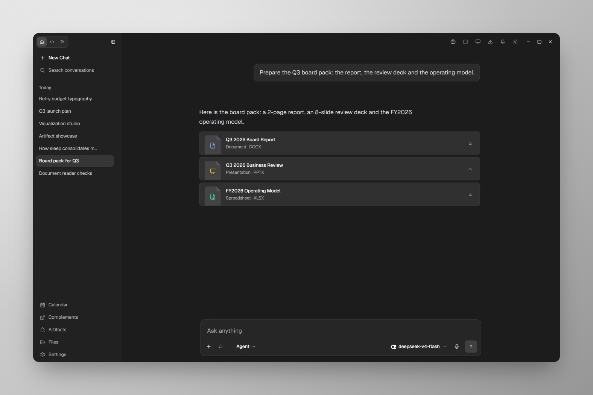
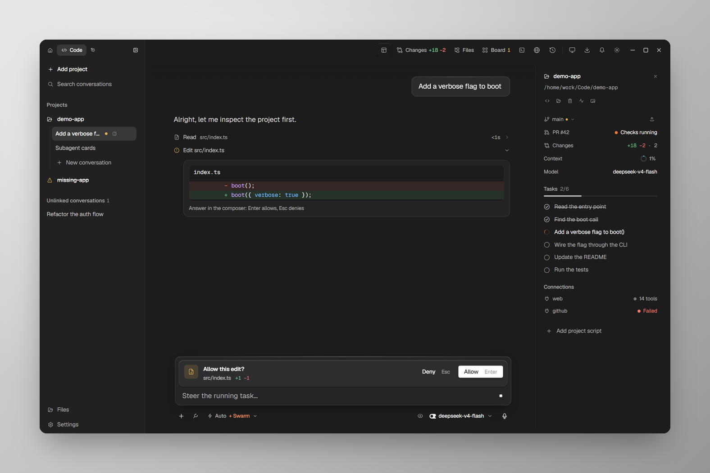
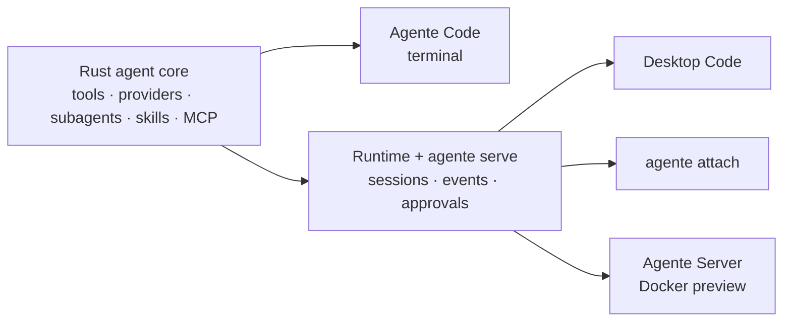

<p align="center">
  
</p>

<h1 align="center">Agente</h1>

<p align="center">
  <strong>Your models. Your workspace. One Rust agent core.</strong><br />
  Build software and work with documents using a shared agent runtime.<br />
  A calm desktop, a keyboard-first terminal, and a runtime you can host yourself.
</p>

<p align="center">
  <a href="https://github.com/fabricio3g/AgenteCode/releases"></a>
  <a href="https://github.com/fabricio3g/AgenteCode/actions/workflows/rust.yml"></a>
  <a href="https://github.com/fabricio3g/AgenteCode/actions/workflows/desktop.yml"></a>
  <a href="LICENSE"></a>
</p>

<p align="center">
  <a href="#get-started">Get started</a> ·
  <a href="#agente-desktop">Desktop</a> ·
  <a href="#agente-code">Code</a> ·
  <a href="#agente-server">Server</a> ·
  <a href="#development">Development</a>
</p>

<p align="center">
  
  <br /><sub>Chat and an artifact preview, side by side. Screenshots show the current UI with demo data.</sub>
</p>

## Choose your workspace

| | Made for | How to use it |
|---|---|---|
| **Agente Desktop** | Chat, local models, research, voice, artifacts, roleplay, and a visual coding workspace | Download a Linux or Windows installer |
| **Agente Code** | Working in a repository without leaving your terminal | Download a Linux or Windows binary |
| **Agente Server** | Keeping sessions running on your own infrastructure | `agente serve` or the Docker image; preview |

Use cloud providers with your own keys, or connect local models. The coding agent uses the Rust core; Desktop talks to the runtime through a local background service.

## Get started

The repository is currently private. Open the release links while signed in
with an account that has repository access, or use the [GitHub CLI](https://cli.github.com)
after `gh auth login`. Anonymous download requests return 404.

### Download Agente Code

The next release uses these Code filenames. Existing assets on the [releases page](https://github.com/fabricio3g/AgenteCode/releases) keep their original names. Choose your platform:

| Platform | Download |
|---|---|
| Linux x86_64 | [AgenteCode-linux-x64](https://github.com/fabricio3g/AgenteCode/releases/latest/download/AgenteCode-linux-x64) |
| Linux arm64 | [AgenteCode-linux-arm64](https://github.com/fabricio3g/AgenteCode/releases/latest/download/AgenteCode-linux-arm64) |
| Debian/Ubuntu amd64 | [AgenteCode-linux-amd64.deb](https://github.com/fabricio3g/AgenteCode/releases/latest/download/AgenteCode-linux-amd64.deb) |
| Debian/Ubuntu arm64 | [AgenteCode-linux-arm64.deb](https://github.com/fabricio3g/AgenteCode/releases/latest/download/AgenteCode-linux-arm64.deb) |
| Windows x64 | [AgenteCode-windows-x64.exe](https://github.com/fabricio3g/AgenteCode/releases/latest/download/AgenteCode-windows-x64.exe) |

On Linux, install to your user bin directory (make sure `~/.local/bin` is on your `PATH`):

```bash
mkdir -p ~/.local/bin
gh release download --repo fabricio3g/AgenteCode --pattern AgenteCode-linux-x64 --output ~/.local/bin/agente --clobber
chmod +x ~/.local/bin/agente
agente --version
```

Use `AgenteCode-linux-arm64` instead on arm64. Debian packages install the `agente` command, terminal launcher, and icons: `sudo apt install ./AgenteCode-linux-amd64.deb` (use the arm64 package on arm64). On Windows, rename the download to `agente.exe` and put it in a folder on your `PATH`.

Verify Code binaries and Debian packages with [AgenteCode-SHA256SUMS](https://github.com/fabricio3g/AgenteCode/releases/latest/download/AgenteCode-SHA256SUMS). Desktop installers and update metadata have their own [AgenteDesktop-SHA256SUMS](https://github.com/fabricio3g/AgenteCode/releases/latest/download/AgenteDesktop-SHA256SUMS).

### Download Agente Desktop

The next release uses the following Desktop installer names (existing release assets retain their original names):

| Platform | Download |
|---|---|
| Linux x86_64 | [AppImage](https://github.com/fabricio3g/AgenteCode/releases/latest/download/AgenteDesktop-linux-x64.AppImage) |
| Debian/Ubuntu amd64 | [.deb package](https://github.com/fabricio3g/AgenteCode/releases/latest/download/AgenteDesktop-linux-amd64.deb) |
| Windows x64 | [Installer](https://github.com/fabricio3g/AgenteCode/releases/latest/download/AgenteDesktop-windows-x64.exe) |

Desktop bundles CPU, Vulkan, CUDA and SYCL runtimes with their required libraries. ROCm is available through the UI download. CUDA can still make installers large; each release includes a component size report. Production source maps are excluded.

On Linux, make the AppImage executable and run it, or install the Debian package with `sudo apt install ./AgenteDesktop-linux-amd64.deb`. AppImages require FUSE 2 (`libfuse2t64` on recent Ubuntu). On Windows, run the installer; this release is unsigned.

Desktop includes its own `agente` runtime. Install the standalone Code binary too if you want to use it in a terminal.

<details>
<summary><strong>Run Desktop from source</strong></summary>

With stable Rust, Node.js 22.12+ and the native build tools for your OS installed:

```bash
git clone https://github.com/fabricio3g/AgenteCode.git
cd AgenteCode/apps/desktop
npm install
npm --prefix renderer install
CARGO_BUILD_JOBS=2 npm run dev
```

The dev command builds `agente` and starts Electron and the renderer. See the [Desktop guide](apps/desktop/README.md) for native-module troubleshooting and local-model setup.

</details>

## Agente Desktop

**A workspace for the whole task.** Move between Home, Code, Design, and Roleplay without juggling separate apps.

- **Chat and research.** Use cloud or local models, search the web, and keep conversations organized.
- **Artifacts beside the conversation.** Preview pages, documents, slides, and spreadsheets, then download the results. Float panels, stack them, or group them as tabs in the workspace.
- **Local inference.** Manage GGUF models and llama.cpp runtimes, with CPU and GPU backends selected for your machine. Available backends depend on the runtime bundle.
- **Voice.** Dictate with whisper.cpp speech-to-text and listen to responses with text-to-speech.
- **Roleplay.** Work with characters, personas, and worlds in a dedicated space.
- **A shared composer.** Attach files, pick a model, tune supported thinking levels, and inspect context usage.
- **Your preferred interface.** Dark and light themes, accessibility settings, and seven UI languages: English, Spanish, Brazilian Portuguese, Chinese, French, German, and Japanese.

### Code, with the workspace around it

<p align="center">
  
  <br /><sub>Review a proposed edit before allowing it. Keep project changes beside the conversation.</sub>
</p>

Desktop's Code section runs the Rust coding agent through `agente serve`. Open projects, follow tool activity, review approvals and diffs, and use docked changes, terminals, processes, and the agent's browser. Revert or fork from messages, and restore file checkpoints when you need to go back.

Each conversation keeps its own panel layout, terminal sessions, and browser tabs and storage. Use panel menus to dock, split, group, or float panels; arrow keys resize focused edges and corners. Hiding a terminal or process panel keeps the work running. Close terminals or stop processes explicitly when you are finished.

## Agente Code

**Stay in the terminal. Keep control of the work.** A keyboard-first TUI with a minimal transcript, session tabs, live tool output, and explicit approvals.

<p align="center">
  
  <br /><sub>Plans, tools, and a persistent session—without leaving your repository.</sub>
</p>

```bash
agente                                  # open the TUI in this folder
agente -p ~/src/my-app                   # work in another project
agente "refactor the auth module"        # start with a prompt
agente --resume                         # reopen a saved session
agente --no-tui "fix the failing test"   # headless; auto-approves tools
```

1. Connect a provider with `/provider`.
2. Pick a model with `/model`; use `Ctrl+T` for supported reasoning levels.
3. Describe the task. Mention files with `@`, run commands with `/`, or open the palette with `Ctrl+P`.

| Capability | What you get |
|---|---|
| **Plan, build, auto** | Start read-only with a plan, approve tools as you build, or use auto-approval. Cycle with `Shift+Tab`. |
| **Parallel tools and subagents** | Read tools run concurrently. Explore, plan, and general-purpose agents work in parallel; writing children get isolated git worktrees. |
| **Skills and MCP** | Load [Agent Skills](https://agentskills.io/specification), custom agents, and MCP tools over stdio or Streamable HTTP. |
| **Sessions and tabs** | Resume saved work, run multiple sessions, queue or steer prompts during a turn, and revert or fork from a message. |
| **Changes and processes** | Review diffs, undo/redo edits, and inspect or stop background dev servers and watchers. |
| **Media input** | Attach images, audio, video, and PDFs to models that support them. |
| **Context and spend** | Automatic compaction, prompt caching, context usage, and per-call and per-subagent cost accounting. Estimates are labeled. |
| **Editor and automation** | Use `--acp-stdio` for Agent Client Protocol integrations, or `--no-tui` for scripts and CI. |

Cloud providers: OpenRouter, OpenCode Go, DeepSeek, Z.AI (GLM), and MiniMax. Local: Ollama, LM Studio, and llama.cpp. Any other OpenAI-compatible endpoint works as a custom provider. Services whose terms forbid using your own key from a third-party app (such as OpenAI, Anthropic, and Gemini directly) are left out; their models are still available through OpenRouter. Model capabilities determine tool, reasoning, and media support.

<details>
<summary><strong>Keyboard shortcuts</strong></summary>

| Key | Action |
|---|---|
| `Enter` | Send; while working, queue; on an empty composer, inject the queue |
| `Shift+Tab` | Cycle plan → build → auto |
| `Esc` `Esc` | Interrupt the turn |
| `Ctrl+P` | Command palette |
| `Ctrl+T` | Reasoning effort |
| `Ctrl+V` | Paste text or attach a clipboard image |
| `Ctrl+X` | Subagents |
| `Ctrl+S` / `Ctrl+N` | Session picker / new session |
| `F2` | New session tab |
| `Ctrl+PgUp` / `Ctrl+PgDn` | Switch tabs |
| `PageUp` / `PageDown` | Scroll the transcript |
| `Ctrl+O` | Edit your prompt in `$EDITOR` |
| `Ctrl+B` | Show session changes |
| `?` / `F1` | All shortcuts |

Useful commands: `/settings`, `/skills`, `/mcp`, `/compact`, `/undo`, `/redo`, `/init`, and `/doctor`.

</details>

<details>
<summary><strong>Configuration and extensions</strong></summary>

TUI settings merge from `~/.agente/config.json` and your project's `agente.json`; the project wins. Provider keys live in `~/.agente/auth.json`. See [`agente.json.example`](agente.json.example) for configuration fields.

Provider routes and cache behavior use shared metadata, with configuration overrides. Newly discovered gateway models stay visible even when their protocol is unknown; set `models.<id>.provider.api_format` to enable one. See [Provider routing and caching](docs/PROVIDERS.md) for precedence, cache rules, and examples.

- **Skills:** folders containing `SKILL.md` in `.agente/skills`, `.agents/skills`, or `.claude/skills`, with user-level equivalents. The agent can select a skill, or you can invoke `/skill-name`.
- **Custom agents:** Markdown definitions in `.agente/agents/*.md`.
- **MCP:** configure servers in `agente.json` or the project's `.mcp.json`. Project servers require approval; read-only tools are available in Plan mode.

The composer status shows `mode │ $spend · cache% │ context`. `~$` marks catalog estimates, `+` means some calls are unpriced, and `free` means the provider explicitly charged zero.

</details>

## Agente Server

**Keep the runtime running. Connect when you need it.** The local service behind Desktop can also run headless for sessions and tools.

```bash
agente serve                         # start the local service
agente serve --status                # check whether it is running
agente attach                        # join the latest runtime session
```

For self-hosting, the preview Docker image is `ghcr.io/fabricio3g/agente-server`. The [Server guide](docs/SERVER.md) covers persistent storage, provider configuration, and remote connections.

## Under the hood

The Rust core handles the agent loop, tools, providers, permissions, subagents, skills, MCP, caching, and compaction. The TUI uses the core directly; Desktop's Code section uses the runtime service. Home chat also has Desktop-specific inference and artifact tooling.



<details>
<summary><strong>Repository map</strong></summary>

| Path | Purpose |
|---|---|
| `crates/agente-core` | Agent loop, tools, providers, permissions, subagents, skills, MCP, compaction |
| `crates/agente-runtime` | Sessions, events, approvals, undo/redo, per-session projects and modes |
| `crates/agente-daemon` | `agente serve` and its transports |
| `crates/agente-tui` | Terminal UI |
| `crates/agente-cli` | The `agente` binary: TUI, headless, ACP, serve, attach |
| `crates/agente-{protocol,session,acp,node}` | Shared types, persistence, editor protocol, Node bindings |
| `apps/desktop` | Electron, Svelte, and TypeScript app |

</details>

## Development

Build the standalone Code binary from the repository root:

```bash
CARGO_BUILD_JOBS=2 cargo build --release --bin agente -j 2
./target/release/agente --version      # Windows: target/release/agente.exe
```

Run Rust checks one crate at a time; substitute the crate you changed:

```bash
cargo fmt --all -- --check
CARGO_BUILD_JOBS=2 cargo check -p agente-core -j 2
CARGO_BUILD_JOBS=2 cargo test -p agente-core -j 2
CARGO_BUILD_JOBS=2 cargo clippy -p agente-core --all-targets -j 2 -- -D warnings
```

Desktop checks, from `apps/desktop`:

```bash
npm run check
npm --prefix renderer test
npm test
npm run fallow:audit
node scripts/gen-protocol-types.mjs --check
```

| Guide | What's inside |
|---|---|
| [Project context](AGENTS.md) | Architecture, UI conventions, and contributor instructions |
| [Desktop development](apps/desktop/docs/DEVELOPMENT.md) | Toolchain and native-module troubleshooting |
| [Server](docs/SERVER.md) | Self-hosting and remote sessions |
| [Releasing](docs/RELEASING.md) | CLI and desktop build and publication workflow |
| [0.2.2 release record](docs/RELEASE_PLAN_0.2.2.md) | Coordinated binaries and installers, packaging work, and validation gates |

## License

[MIT](LICENSE). Brand assets live in [`assets/brand`](assets/brand); the wordmark uses [Space Grotesk](https://github.com/floriankarsten/space-grotesk), licensed under the SIL Open Font License 1.1.
